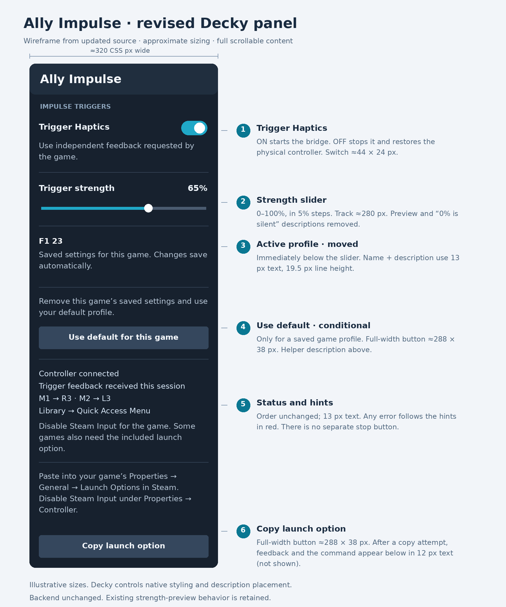

# Expected Decky interface

This wireframe shows the current control order with an example running game and saved profile. It is an illustration, not a screenshot or a proposed UI change. The complete panel is shown; on-device it scrolls.

## Control order

1. **Trigger Haptics** toggle. Turning it off invokes the existing backend stop-and-restore command.
2. **Trigger strength** slider, without a preview/silent description. Strength preview behavior is retained.
3. Active profile name and description.
4. **Use default for this game**, when applicable.
5. Connection/feedback status and hints.
6. **Copy launch option**, followed by copy feedback when applicable.

There is no separate **Stop controller bridge** button. The Python backend is unchanged.

## Sizing

- The drawing assumes an approximately 320 CSS-pixel-wide panel, with 16-pixel side padding.
- Profile and status text are explicitly set to **13 px** with **19.5 px** line height in the source.
- The copied-command note is explicitly **12 px** and appears only after a copy attempt; it is omitted from the illustration.
- Button sizes (approximately **288 × 38 px**), switch size (approximately **44 × 24 px**) and slider width (approximately **280 px**) are illustrative. Decky supplies their native styling, fonts and spacing; actual rendering may differ across Steam/Decky versions and display scaling.
- Native Decky components also determine description placement and wrapping within each control group.

## Conditional content

- **Use default for this game** appears only when the running game has a saved override.
- Controller feedback status appears while the virtual controller is ready.
- Errors appear after the status/hints block when present.
- Copy feedback and the launch command appear immediately after the copy-button block following a copy attempt.
